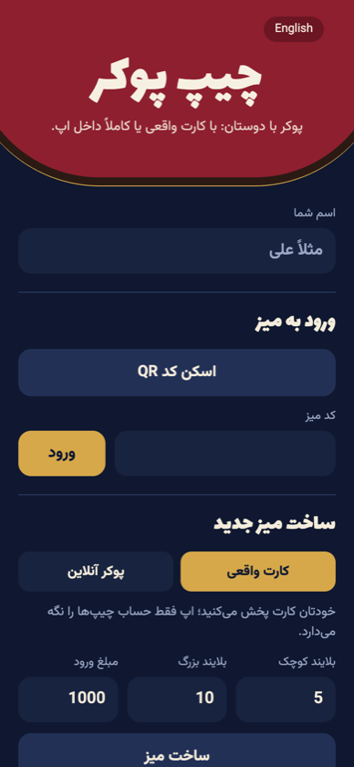
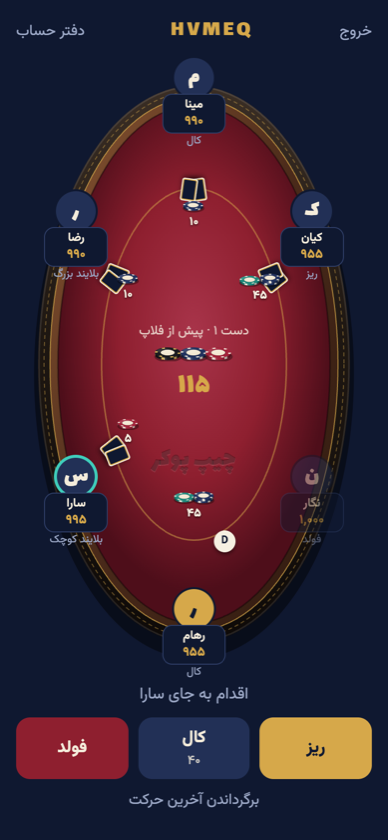
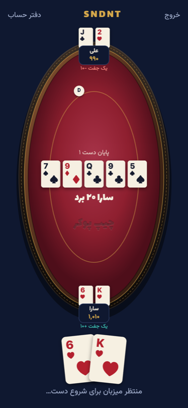
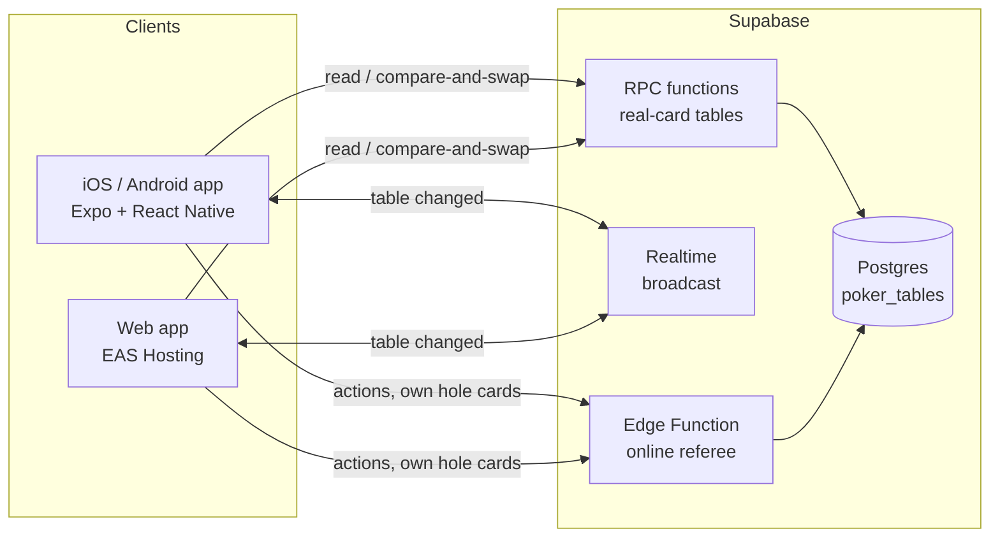

# Poker Chips

Poker night with friends, where every phone is part of the table. Players
join a table by room code, link or QR code, and the app takes care of the
chips, or of the whole game.

**Live demo:** https://poker-chips.expo.app (works in any phone or desktop browser, no install needed)

<p>
  
  
  
  
</p>

There are two kinds of table:

- **Real cards.** You deal a physical deck and the app replaces the chips:
  stacks, bets, pots, side pots, rebuys and who owes whom at the end of the night.
- **Online poker.** The app deals as well. A server-side referee shuffles and
  deals, each phone only ever receives its own two cards, and the winner is
  decided automatically.

The app runs on iOS, Android and the web from one codebase, in Persian
(right-to-left) and English.

> Play-money only. The app tracks chips between friends; it never moves real money.

## Features

- Texas Hold'em betting rules: blinds, minimum raises, all-ins, side pots,
  split pots and odd-chip rules, heads-up blind order.
- Tables shared live between phones and browsers through one backend.
- Invites by room code, copyable link, share sheet or QR code, plus an
  in-app QR scanner.
- A ledger with buy-ins, rebuys, results and the fewest transfers that settle everyone up.
- Host tools: start hands, act for a player whose phone is away, add a
  player without a phone, undo the last action (real-card tables).
- Installable as a web app, with a link preview image for invites.

## Architecture



- **One game engine, two places.** `src/engine` is pure TypeScript with no UI
  or network code. The app uses it to validate moves on real-card tables, and
  the same code is bundled into the Supabase Edge Function that referees
  online tables (`npm run build:functions`).
- **Concurrent actions.** Every table row has a version. A write only succeeds
  if it was based on the latest version (compare-and-swap); otherwise the
  client reloads, re-validates and retries, so two phones acting at once
  can never corrupt a table.
- **Hidden information.** On online tables the deck and hole cards live in a
  private column that only the Edge Function can read. Shuffling uses the
  platform's cryptographic random generator, and a player can fetch only
  their own cards, proven by a per-device secret.
- **Locked-down database.** Row-level security is on with no policies;
  clients go through a few narrow RPCs, and online tables refuse any change
  that does not come from the referee.
- **Live updates.** After each change the client sends a Realtime broadcast,
  and other devices refetch. A slow poll covers missed messages.

## Tests

```bash
npm test
```

22 tests cover the engine: betting order, minimum raises, side pots, uncalled
bets, odd chips, undo, settlement, hand ranking and tie-breakers, dealing
privacy, plus randomized fuzz tests that play hundreds of games and check
that chips are never created or lost and every hand finishes.

## Tech stack

TypeScript, React Native 0.88, Expo SDK 58, Expo Router, react-native-svg,
expo-camera, Supabase (Postgres, RPC, Realtime, Edge Functions on Deno),
EAS Hosting, Node test runner, ESLint.

## Run it yourself

```bash
npm install
npx expo start        # then press i / a / w, or scan the QR code with Expo Go
npm test
npm run typecheck
npm run lint
```

Without a server configured the app runs in a local trial mode: tables live
on one device only.

### Server (Supabase)

- `supabase/migrations/`: the table and the RPCs used by real-card tables.
  Apply with `npx supabase db push --remote`.
- `supabase/functions/poker/`: the referee for online tables. It imports the
  game rules from `supabase/functions/_shared/engine.js`, which is generated
  from `src/engine`. After changing the engine run `npm run deploy:functions`.

Put the project URL and publishable key in `.env` (see `.env.example`), then
restart with `npx expo start --clear`. `.env` is not committed.

### Website

```bash
npm run deploy:web    # export the web build and publish it as production
```

`EXPO_PUBLIC_*` values are baked in at export time from `.env`.

## Project layout

- `src/engine/`: game rules. Betting in `engine.ts`, cards and hand ranking in
  `cards.ts`, dealing and showdown in `online.ts`.
- `src/net/`: table storage and sync (Supabase, or local storage as a fallback).
- `src/app/`: screens (Expo Router).
- `src/ui/`: components: the table, chips, cards, ledger, invite sheet, and all
  text in `i18n.ts`.
- `supabase/`: migrations and the referee Edge Function.
